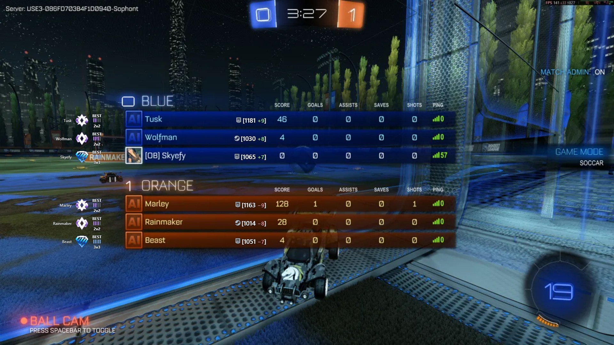
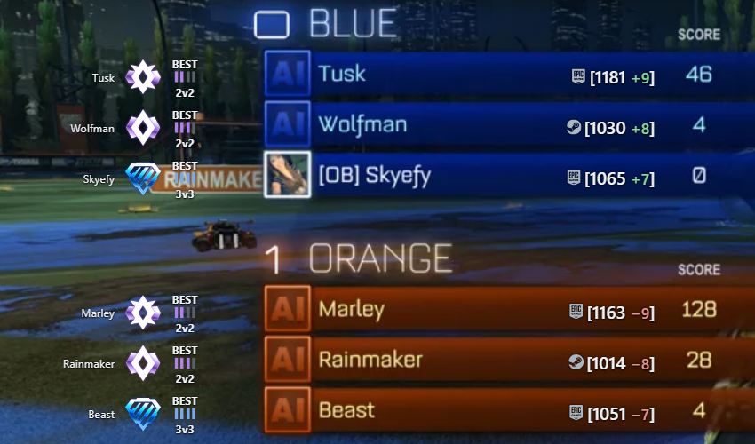
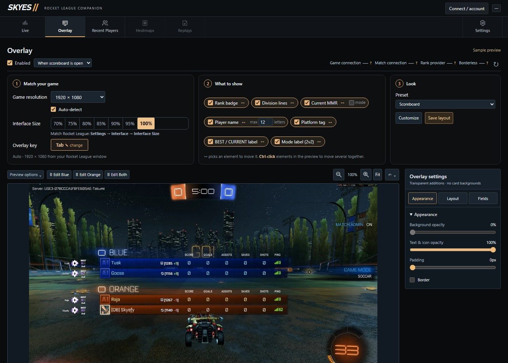

# Skyes Overlay

A Rocket League overlay that shows every player's rank right on the scoreboard while you hold the scoreboard key (Tab by default): their best rank badge, division, the mode it's from, and their MMR.

Windows 10/11, Steam or Epic. **[Download the latest release](https://github.com/OfficialSkyefy/skyes-overlay/releases/latest)**



## What you see



For every player, next to their scoreboard row:

- **Name** and **best rank badge**: their highest rank across ranked 1v1, 2v2 and 3v3
- **BEST**, the **division** (I–IV: the four bars fill left to right) and the **mode** that rank is from
- **Platform** (Steam, Epic, PlayStation, Xbox, Switch) and **MMR**, with the change from the last match

Ranks fill in a few seconds into the match. Ones Skyes has seen before show instantly.

## Make it yours



The Overlay page previews the overlay on a real scoreboard:

1. **Match your game**: resolution (auto-detected), Interface Size and the overlay key (keyboard or controller)
2. **What to show**: tick elements on or off, drag them anywhere, or Ctrl-click several to move them together
3. **Look**: presets, opacity and size

## Install

**Option 1: one command (recommended).** Press <kbd>Win</kbd>, type `powershell`, open **Windows PowerShell**, paste this and press Enter:

```powershell
irm https://raw.githubusercontent.com/OfficialSkyefy/skyes-overlay/main/install.ps1 | iex
```

It downloads the latest release, installs it to `%LOCALAPPDATA%\Programs\Skyes Overlay`, adds Start Menu and Desktop shortcuts, and starts Skyes. No admin rights needed, and no "Windows protected your PC" warning. You can read [install.ps1](install.ps1) before running it.

**Option 2: download the zip.**

1. Download **SkyesOverlay.zip** from the [latest release](https://github.com/OfficialSkyefy/skyes-overlay/releases/latest).
2. Right-click the zip → **Properties** → tick **Unblock** → **OK**. This prevents the "Windows protected your PC" warning.
3. Extract it anywhere (for example your Desktop) and run `Skyes Desktop Alpha.exe`.

If Windows still shows "Windows protected your PC", click **More info** → **Run anyway**. It appears because the app isn't code-signed, not because anything is wrong. Each release links its [VirusTotal](https://www.virustotal.com) scan in the release notes.

## First run

1. Open Rocket League. The first time, Skyes turns on the game's local Stats API and asks you to restart Rocket League once. It backs up the config files it changes (`DefaultStatsAPI.ini`, `TAStatsAPI.ini`) first.
2. Use **Borderless** window mode in Rocket League.
3. In Skyes, open **Overlay** → step 1 **Match your game** and set **Interface Size** to match Rocket League (**Settings → Interface → Interface Size**). The resolution is detected automatically.
4. Join a match and hold Tab.

Exactly calibrated for 1920×1080, 2560×1440 and 3840×2160; other widescreen resolutions are estimated.

## Updates

Skyes checks this page for a newer build when it starts and shows an **Update now** bar. One click downloads it, swaps the files and reopens Skyes. You can turn this off in **Settings → Updates**.

## Privacy

- Rank lookups (on by default) send players' account IDs or display names to Tracker.gg over HTTPS. The last results are kept in a small file on your PC. Turn them off in **Settings → External rank lookups**.
- Update checks contact GitHub.
- Nothing else leaves your PC. Skyes reads the game's own local Stats API feed and its log file (to find your account). It never reads game memory, and the only game files it changes are the two Stats API config files above.

## Uninstall

Delete `%LOCALAPPDATA%\Programs\Skyes Overlay` (or wherever you extracted it), `%LOCALAPPDATA%\SkyesDesktopAlpha`, and the Skyes Overlay shortcuts. To undo the Stats API change, copy the `.bak` files next to the two config files back over the originals.

## Problems?

Skyes writes a status report (no names or IDs) to `%LOCALAPPDATA%\SkyesDesktopAlpha\diagnostics.json`. Grab it while you're in a match holding Tab and send it along with a screenshot.

---

Skyes Overlay is a fan project and is not affiliated with or endorsed by Psyonix, Epic Games or Tracker.gg. Rocket League and its rank artwork belong to Psyonix.
