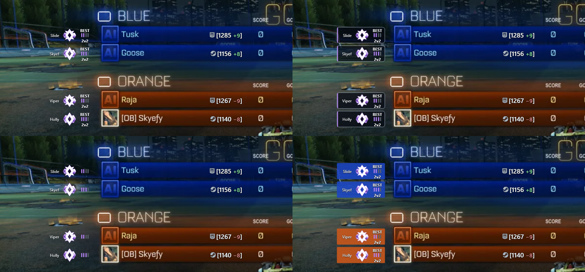
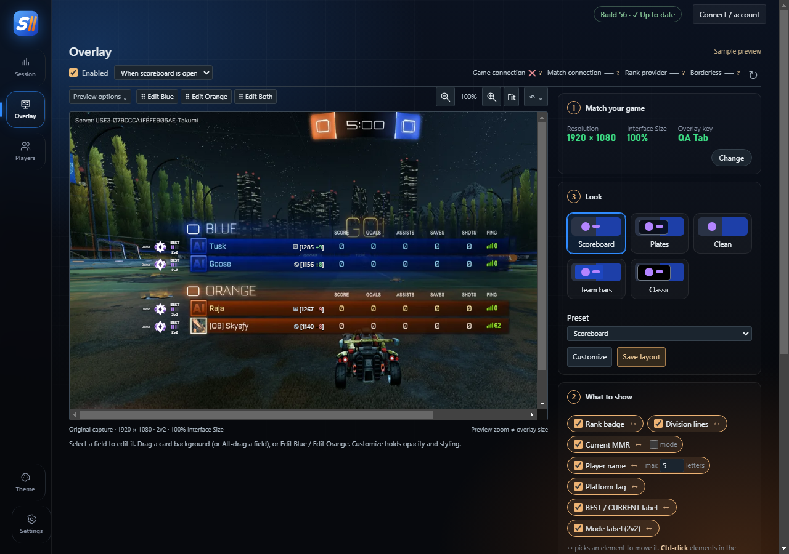
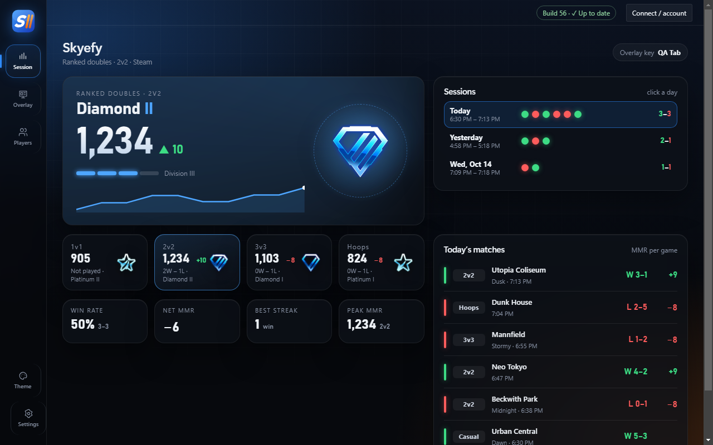

# SRLC · Skye's Rocket League Companion

See every player's rank right on the Rocket League scoreboard while you hold your scoreboard button (Tab, or L1 / LB on a controller): their best rank badge, division, the mode it's from, and their MMR. Plus your own rank, MMR and every match of your session.

Windows 10/11, Steam or Epic. **[Download the latest release](https://github.com/OfficialSkyefy/srlc/releases/latest)**


## What you see in game


For every player, next to their scoreboard row:

- **Name** and **best rank badge**: their highest rank across ranked 1v1, 2v2 and 3v3
- **BEST**, the **division** (I–IV: the four bars fill left to right) and the **mode** that rank is from
- **Platform** (Steam, Epic, PlayStation, Xbox, Switch) and **MMR**, with the change from the last match

Ranks fill in a few seconds into the match. Ones SRLC has seen before show instantly.

## Pick a style



Choose **Scoreboard**, **Plates**, **Clean**, **Team bars** or **Classic** on the Overlay page, then move, resize or hide anything. Ctrl-click several elements to move them together, and save your own layouts.



## Your session



The **Session** page shows your rank and MMR for every mode, today's record and MMR change, every match with its map and MMR change, and your past sessions. During a match it shows the live score and both teams' ranks.

Pick a theme (Glass, Broadcast, Neon, Minimal or Dashboard) and a side or top menu under **Theme**.

## Install

**Option 1: one command (recommended).** Press <kbd>Win</kbd>, type `powershell`, open **Windows PowerShell**, paste this and press Enter:

```powershell
irm https://raw.githubusercontent.com/OfficialSkyefy/srlc/main/install.ps1 | iex
```

It downloads the latest release, installs it to `%LOCALAPPDATA%\Programs\Skyes Overlay`, adds **SRLC** shortcuts to the Start Menu and Desktop, and starts it. No admin rights needed, and no "Windows protected your PC" warning. You can read [install.ps1](install.ps1) before running it.

**Option 2: download the zip.**

1. Download **SkyesOverlay.zip** from the [latest release](https://github.com/OfficialSkyefy/srlc/releases/latest).
2. Right-click the zip → **Properties** → tick **Unblock** → **OK**. This prevents the "Windows protected your PC" warning.
3. Extract it anywhere (for example your Desktop) and run `Skyes Desktop Alpha.exe`.

If Windows still shows "Windows protected your PC", click **More info** → **Run anyway**. It appears because the app isn't code-signed, not because anything is wrong. Each release links its [VirusTotal](https://www.virustotal.com) scan in the release notes.

## First run

1. SRLC asks you to confirm your game resolution and Interface Size (Rocket League → **Settings → Interface → Interface Size**) and to press your scoreboard button.
2. Open Rocket League. The first time, SRLC turns on the game's local Stats API and asks you to restart Rocket League once. It backs up the config files it changes (`DefaultStatsAPI.ini`, `TAStatsAPI.ini`) first.
3. Use **Borderless** window mode in Rocket League.
4. Join a match and hold your scoreboard button.

Exactly calibrated for 1920×1080, 2560×1440 and 3840×2160; other widescreen resolutions are estimated.

## Updates

SRLC checks this page for a newer build when it starts and shows an **Update now** bar. One click downloads it, swaps the files and reopens it. Click the version badge in the top right to check again at any time. You can turn off the automatic check in **Settings → Updates**.

## Privacy

- Rank lookups (on by default) send players' account IDs or display names to Tracker.gg over HTTPS. The last results are kept in a small file on your PC. Turn them off in **Settings → External rank lookups**.
- Update checks contact GitHub.
- Nothing else leaves your PC. SRLC reads the game's own local Stats API feed and its log file (to find your account). It never reads game memory, and the only game files it changes are the two Stats API config files above.

## Uninstall

Delete `%LOCALAPPDATA%\Programs\Skyes Overlay` (or wherever you extracted it), `%LOCALAPPDATA%\SkyesDesktopAlpha`, and the SRLC shortcuts. To undo the Stats API change, copy the `.bak` files next to the two config files back over the originals.

## Problems?

SRLC writes a status report (no names or IDs) to `%LOCALAPPDATA%\SkyesDesktopAlpha\diagnostics.json`. Grab it while you're in a match holding your scoreboard button and send it along with a screenshot.

---

SRLC is a fan project and is not affiliated with or endorsed by Psyonix, Epic Games or Tracker.gg. Rocket League and its rank artwork belong to Psyonix.
